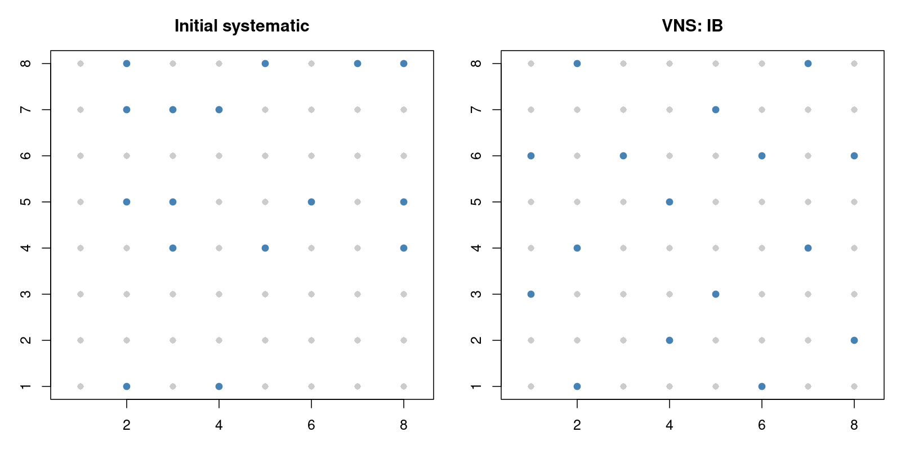

# OptSampling

**Optimize fixed-size sampling designs while preserving prescribed first-order
inclusion probabilities.** OptSampling provides variable neighborhood search
(VNS) for systematic sampling orderings and conditional optimal sampling
(COS/ACOS) through revised simplex with column generation.

VNS can target multivariate balance, spatial spreading, or the mean squared
error (MSE) of a Horvitz–Thompson (HT) total. COS searches a broader class of
sampling designs for the HT-MSE objective. Both return a **sampling design**;
a separate random draw selects the actual sample.

This tutorial uses small, synthetic populations. The examples are independent
of the article's experiments and require no external data files. Run the code
blocks in order in a fresh R session; later sections reuse objects and helpers
introduced earlier. Installation blocks only need to be run once. Optional
examples run only when the relevant additional package is installed.

## Contents

1. [Getting started](#1-getting-started)
2. [Understanding systematic designs and their outputs](#2-understanding-systematic-designs-and-their-outputs)
3. [Optimizing systematic designs with VNS](#3-optimizing-systematic-designs-with-vns)
4. [Multiple starts and continuation budgets](#4-multiple-starts-and-continuation-budgets)
5. [Conditional optimal sampling with COS and ACOS](#5-conditional-optimal-sampling-with-cos-and-acos)
6. [Simple applications and benchmark comparisons](#6-simple-applications-and-benchmark-comparisons)
7. [Additional tools](#7-additional-tools)
8. [Practical guidance and troubleshooting](#8-practical-guidance-and-troubleshooting)

## 1. Getting started

### Installation

OptSampling requires **R >= 4.1.0**. Install the development version from GitHub:

```r
# Installation only: skip this block when following an already installed copy.
install.packages("remotes")
remotes::install_github("pgsegador/OptSampling")
```

The package uses Rcpp and Matrix. Its C++ code is compiled during installation,
not each time you load it. Source installation requires Rtools on Windows,
the Xcode command-line tools on macOS, or the R development tools and a C++
compiler on Linux.

The core examples use only OptSampling and its required dependencies. Optional
integrations are:

| Package | Used for |
| --- | --- |
| `sampling` | Cube sampling and a simple random sampling benchmark |
| `TSP` | Traveling-salesman initial orderings |
| `WaveSampling` | Automatic construction of spatial weights for IB |

To enable those sections, install the packages you need with
`install.packages(c("sampling", "TSP", "WaveSampling"))`.

### Inputs and notation

A population consists of `N` units labeled `1, ..., N`. Supply:

- `pik`: a numeric vector of first-order inclusion probabilities, in the original
  population-label order. Its sum must be the desired integer sample size `n`.
- `X`: a finite numeric matrix with one row per unit. Its columns contain
  balancing variables or, for spatial examples, coordinates.
- `start`: optionally, a permutation of `1:N`. It changes the sampling order;
  **do not reorder `pik` or `X` yourself when supplying this argument**.

VNS accepts `0 < pik <= 1`, including certainty units. COS/ACOS requires strictly
interior probabilities, `0 < pik < 1`. Neither accepts zero inclusion probabilities.

### A first complete example

```r
library(OptSampling)

set.seed(11)
N_quick <- 12L
pik_quick <- rep(3 / N_quick, N_quick)
X_quick <- cbind(
  size = runif(N_quick, 1, 5),
  auxiliary = runif(N_quick, 2, 8)
)

quick_fit <- vns_systematic(
  pik = pik_quick,
  X = X_quick,
  objective = "balance",
  n_starts = 3,
  seed = 12,
  verbose = FALSE
)
print(quick_fit)
summary(quick_fit)

s_quick <- draw_systematic_sample(quick_fit, seed = 13)
s_quick                         # Original population labels
X_quick[s_quick, , drop = FALSE] # Rows selected for observation
```

The fit optimizes expected balance over all possible samples of its systematic
design. `s_quick` is only one realization from that design. A good design need
not produce the smallest possible loss on every individual draw.

## 2. Understanding systematic designs and their outputs

### An order defines a complete design

For fixed `pik`, each population ordering determines a systematic design.
`systematic_support()` returns the possible samples and their probabilities:

```r
q_quick <- systematic_support(pik_quick, quick_fit$sigma)
q_quick$samples
q_quick$probabilities
sum(q_quick$probabilities)
lengths(q_quick$samples)
```

`samples` is a **list of vectors of unit labels**, not a binary incidence
matrix. Every vector has length `n`. The probabilities sum to one, up to
floating-point precision. Here, equal probabilities `3/12` give four possible
samples, each with probability `1/4`.

You can check that the design realizes the requested inclusion probabilities:

```r
inclusion_from_support <- function(samples, probabilities, N) {
  inclusion <- numeric(N)
  for (j in seq_along(samples)) {
    inclusion[samples[[j]]] <- inclusion[samples[[j]]] + probabilities[j]
  }
  inclusion
}

pik_check <- inclusion_from_support(
  q_quick$samples, q_quick$probabilities, N_quick
)
max(abs(pik_check - pik_quick)) # Should be close to zero
```

### Sample losses and expected losses

A sample loss is a function `loss(s)` of the selected labels. Its expected
value is the probability-weighted average across the design's support.
The following **tutorial helper** is ordinary R code, not an exported
OptSampling function:

```r
expected_systematic_loss <- function(pik, sigma, loss) {
  q <- systematic_support(pik, sigma)
  costs <- vapply(q$samples, loss, numeric(1))
  sum(q$probabilities * costs)
}

ht_total <- function(s, values, pik) {
  sum(values[s] / pik[s])
}

relative_balance_loss <- function(s, X, pik, scale = abs(colSums(X))) {
  estimated <- colSums(sweep(X[s, , drop = FALSE], 1, pik[s], "/"))
  sum(((estimated - colSums(X)) / scale)^2)
}

quick_loss <- function(s) relative_balance_loss(s, X_quick, pik_quick)
c(
  from_support = expected_systematic_loss(
    pik_quick, quick_fit$sigma, quick_loss
  ),
  from_optimizer = quick_fit$final_objective
)
```

The two values should agree numerically. You can also evaluate a permutation
without optimizing it:

```r
vns_objective(
  sigma = quick_fit$sigma,
  pik = pik_quick,
  X = X_quick,
  objective = "balance"
)
```

## 3. Optimizing systematic designs with VNS

### 3.1. Basic usage and search controls

`vns_systematic()` minimizes the exact expected loss of a systematic design by
changing its population order. It preserves the supplied `pik` throughout the
search.

| Argument | Meaning |
| --- | --- |
| `objective` | `"balance"` or `"spread"` |
| `objective_control` | Metric, scales, coordinates, or spatial weight matrix |
| `start` | One initial permutation, or a systematic-mixture warm start |
| `n_starts` | Number of random starts when no explicit start is supplied |
| `search` | `"type1"`, `"type2"`, or `"adaptive"` (default) |
| `max_iter` | Maximum accepted moves per run, not objective evaluations |
| `max_time` | Time limit in seconds per run; default `Inf` |
| `improvement_tol` | Absolute improvement required to accept a move |
| `tol_pik` | Numerical tolerance for support calculations |
| `seed`, `verbose` | Random seed and progress printing |

Type I explores circular adjacent exchanges, including the last/first pair.
Type II explores all transpositions. Adaptive search combines fast adjacent
search with broader transposition checks. A certificate describes a **local**
minimum over the relevant neighborhood and within the chosen tolerance.

### 3.2. Balancing auxiliary totals

Create 40 units with two normal auxiliary variables and a Bernoulli group
indicator. The normal variables have positive means, so their totals provide
sensible relative scales.

```r
set.seed(21)
N_bal <- 40L
n_bal <- 10L
pik_bal <- rep(n_bal / N_bal, N_bal)
x1 <- rnorm(N_bal, mean = 10, sd = 2)
x2 <- 2 + 0.5 * x1 + rnorm(N_bal)
group <- rbinom(N_bal, size = 1, prob = 0.4)
X_bal <- cbind(x1 = x1, x2 = x2, group = group)
sigma_bal <- sample.int(N_bal)

balance_relative <- vns_systematic(
  pik_bal, X_bal,
  objective = "balance",
  objective_control = list(metric = "relative"),
  start = sigma_bal,
  verbose = FALSE
)

balance_projection <- vns_systematic(
  pik_bal, X_bal,
  objective = "balance",
  objective_control = list(metric = "mahalanobis"),
  start = sigma_bal,
  verbose = FALSE
)
```

**Relative balance** minimizes

$$
E\left[\sum_j\left\{\frac{\widehat X_{HT,j}(S)-X_{U,j}}{a_j}\right\}^2\right],
$$

where `a_j = abs(sum(X[, j]))` by default. To use your own positive scales,
set `objective_control = list(metric = "relative", scale = scales)`.
For centered variables, using near-zero totals as divisors is inappropriate:

```r
X_centered <- scale(X_bal, center = TRUE, scale = FALSE)
centered_scales <- N_bal * apply(X_centered, 2, sd)
balance_centered <- vns_systematic(
  pik_bal, X_centered,
  objective_control = list(metric = "relative", scale = centered_scales),
  start = sigma_bal,
  verbose = FALSE
)
```

**Projection/Mahalanobis balance** accounts for the joint geometry of the
balancing variables. If `Z = sweep(X, 1, pik, "/")` and `d` is the vector of HT
total discrepancies, the sample loss is `d' (Z'Z)^+ d`. The pseudoinverse allows
redundant columns; `mahalanobis_tol` controls the eigenvalue cutoff.
This is a projection criterion, not the inverse of the usual centered covariance
matrix. An explicitly supplied relative `scale` is ignored for this metric.

Evaluate both final designs under both criteria:

```r
orders_bal <- list(
  Initial = sigma_bal,
  VNS_relative = balance_relative$sigma,
  VNS_projection = balance_projection$sigma
)
balance_cross <- data.frame(
  design = names(orders_bal),
  relative = vapply(orders_bal, function(ord) {
    vns_objective(ord, pik_bal, X_bal,
                  objective_control = list(metric = "relative"))
  }, numeric(1)),
  projection = vapply(orders_bal, function(ord) {
    vns_objective(ord, pik_bal, X_bal,
                  objective_control = list(metric = "mahalanobis"))
  }, numeric(1))
)
print(balance_cross, row.names = FALSE, digits = 5)
```

Example output for the seeded population:

| Design | Expected relative loss | Expected projection loss |
| --- | --- | --- |
| Initial | 0.0336718 | 0.358018 |
| VNS relative | 0.0204086 | 0.0273192 |
| VNS projection | 0.0259142 | 0.0180313 |

Compare values **within a column**: the two losses have different scales.
Optimizing one criterion does not guarantee the best result under the other.
For a realized sample, inspect the individual total discrepancies:

```r
s_bal <- draw_systematic_sample(balance_relative, seed = 22)
hat_bal <- colSums(sweep(X_bal[s_bal, , drop = FALSE], 1, pik_bal[s_bal], "/"))
data.frame(
  variable = colnames(X_bal),
  population_total = colSums(X_bal),
  HT_total = hat_bal,
  discrepancy = hat_bal - colSums(X_bal)
)
```

### 3.3. Spatial spreading on a small grid

#### IB on an exact 8 by 8 grid

Select 16 of 64 grid points. Define a symmetric weight matrix connecting
horizontal and vertical neighbors. This is a simple, explicitly specified
spatial graph; it does not require WaveSampling.

```r
coords_grid <- as.matrix(expand.grid(x = 1:8, y = 1:8))
N_grid <- nrow(coords_grid)
n_grid <- 16L
pik_grid <- rep(n_grid / N_grid, N_grid)
D_grid <- as.matrix(dist(coords_grid))
W_grid <- 1 * (abs(D_grid - 1) < 1e-12)
diag(W_grid) <- 0

set.seed(31)
sigma_grid <- sample.int(N_grid)
spread_ib <- vns_systematic(
  pik_grid, coords_grid,
  objective = "spread",
  objective_control = list(metric = "ib", W = W_grid),
  start = sigma_grid,
  max_iter = 5000L,
  verbose = FALSE
)

c(
  initial_IB = spread_ib$initial_objective,
  optimized_IB = spread_ib$final_objective
)
```

IB is the normalized Moran-type spatial criterion implemented by the package.
**Smaller is better**, and values can be negative. `W` defines what counts as
local proximity; different weight matrices define different objectives.
The diagonal is ignored, total weight must be positive, and every row needs a
positive weight sum. Dense and sparse `Matrix` representations are accepted.

To illustrate the samples, draw from the initial and optimized designs:

```r
draw_from_order <- function(pik, sigma, seed) {
  set.seed(seed)
  q <- systematic_support(pik, sigma)
  q$samples[[sample.int(length(q$samples), 1, prob = q$probabilities)]]
}

s_grid_initial <- draw_from_order(pik_grid, sigma_grid, seed = 32)
s_grid_ib <- draw_systematic_sample(spread_ib, seed = 32)

plot_grid_samples <- function(coords, samples, titles) {
  old_par <- par(mfrow = c(1, length(samples)), mar = c(3, 3, 3, 1))
  on.exit(par(old_par))
  for (j in seq_along(samples)) {
    plot(coords, asp = 1, pch = 16, col = "grey80",
         xlab = "x", ylab = "y", main = titles[j])
    points(coords[samples[[j]], , drop = FALSE], pch = 19, col = "steelblue")
  }
}
plot_grid_samples(
  coords_grid,
  list(s_grid_initial, s_grid_ib),
  c("Initial systematic", "VNS: IB")
)
```



These plots show individual draws. The expected objective, rather than one
visually appealing sample, is the appropriate design comparison.

#### SB on a slightly perturbed grid

SB is a Voronoi balance loss: assign each population unit to its closest sampled
unit and sum its inclusion probability within that cell. Ideally, each sampled
unit represents cell mass one. The loss is the average squared deviation from
that target.

**Current limitation:** exact distance ties on a regular lattice can make the
incremental equal-probability SB search repeat moves without actual progress.
For the SB illustration, perturb each coordinate by at most 0.01 grid units.
This changes the geometry slightly and avoids exact ties; the example remains
a grid-based synthetic population. Use the IB example above when an exact
regular grid must be retained.

```r
set.seed(33)
coords_sb <- coords_grid + matrix(
  runif(length(coords_grid), -0.01, 0.01), ncol = 2
)
spread_sb <- vns_systematic(
  pik_grid, coords_sb,
  objective = "spread",
  objective_control = list(metric = "sb"),
  start = sigma_grid,
  max_iter = 5000L,
  verbose = FALSE
)
s_grid_sb <- draw_systematic_sample(spread_sb, seed = 34)
plot_grid_samples(coords_sb, list(s_grid_sb), "VNS: SB (perturbed grid)")
summary(spread_sb)
```

The next helper implements the sample-level SB loss in R for later benchmark
comparisons. Its coordinates are the **perturbed** coordinates above. With no
distance ties, the order of the selected labels does not affect the result.

```r
D_sb <- as.matrix(dist(coords_sb))
sb_loss <- function(s, D, pik) {
  nearest <- max.col(-D[, s, drop = FALSE], ties.method = "first")
  cell_mass <- vapply(seq_along(s), function(j) {
    sum(pik[nearest == j])
  }, numeric(1))
  mean((cell_mass - 1)^2)
}
grid_sb_loss <- function(s) sb_loss(s, D_sb, pik_grid)

c(
  from_support = expected_systematic_loss(
    pik_grid, spread_sb$sigma, grid_sb_loss
  ),
  from_optimizer = spread_sb$final_objective
)
```

For IB weights derived automatically from coordinates and inclusion
probabilities, install WaveSampling and omit `W`. That choice uses
`WaveSampling::wpik()` and defines a different weight matrix from the simple
grid graph above:

```r
if (requireNamespace("WaveSampling", quietly = TRUE)) {
  spread_auto_weights <- vns_systematic(
    pik_grid, coords_sb,
    objective = "spread",
    objective_control = list(metric = "ib"),
    start = sigma_grid,
    max_iter = 5000L,
    verbose = FALSE
  )
  summary(spread_auto_weights)
}
```

### 3.4. Minimizing the variance of an HT total

For fixed population values `v`, define

$$
\widehat T_{HT}(S)=\sum_{k\in S}\frac{v_k}{\pi_k}.
$$

Because the design preserves the positive inclusion probabilities, this
estimator is unbiased for `sum(v)`. Its design MSE therefore equals its design
variance. VNS computes that MSE using `objective = "balance"`, a one-column
matrix, and **`scale = 1`**. There is no separate `objective = "variance"` option.

Create auxiliary information `x_var`, a design-stage prediction `proxy_var`,
and a study variable `y_var` with residual variation. This example uses a strong but imperfect proxy, with signal coefficient 4 and
residual standard deviation 0.5. The proxy is defined without fitting to `y_var`
or choosing it using the evaluation results.

```r
set.seed(41)
N_var <- 18L
n_var <- 6L
x_var <- rnorm(N_var)
proxy_var <- 20 + 4 * x_var
y_var <- proxy_var + rnorm(N_var, sd = 0.5)
pik_var <- cos_pps_inclusion_probabilities(exp(0.15 * x_var), n_var)
sigma_var <- sample.int(N_var)

# Teaching example: variance minimization when the target values are known.
variance_known <- vns_systematic(
  pik_var, matrix(y_var, ncol = 1),
  objective = "balance",
  objective_control = list(metric = "relative", scale = 1),
  start = sigma_var,
  verbose = FALSE
)

# Operational design-stage example: optimize using only the proxy.
variance_proxy <- vns_systematic(
  pik_var, matrix(proxy_var, ncol = 1),
  objective = "balance",
  objective_control = list(metric = "relative", scale = 1),
  start = sigma_var,
  verbose = FALSE
)

mse_loss <- function(s, values, pik) {
  (ht_total(s, values, pik) - sum(values))^2
}
y_loss <- function(s) mse_loss(s, y_var, pik_var)
proxy_loss <- function(s) mse_loss(s, proxy_var, pik_var)

variance_orders <- list(
  Initial = sigma_var,
  VNS_known_values = variance_known$sigma,
  VNS_proxy = variance_proxy$sigma
)
variance_table <- data.frame(
  design = names(variance_orders),
  proxy_MSE = vapply(variance_orders, function(ord) {
    expected_systematic_loss(pik_var, ord, proxy_loss)
  }, numeric(1)),
  study_variable_MSE = vapply(variance_orders, function(ord) {
    expected_systematic_loss(pik_var, ord, y_loss)
  }, numeric(1))
)
print(variance_table, row.names = FALSE, digits = 5)
cor(proxy_var, y_var)
```

`variance_known` is a teaching benchmark using information normally unavailable
before sampling. `variance_proxy` uses only the auxiliary proxy to choose the
design. Its final objective is **proxy MSE**, not true-study-variable MSE.
Improving proxy MSE does not guarantee improving the true MSE; the table makes
that distinction visible. These losses are exact sums over the supports, not
Monte Carlo estimates.

### 3.5. Reading and diagnosing VNS results

A `vns_systematic_fit` contains:

| Field | Interpretation |
| --- | --- |
| `sigma` | Final population ordering, using original labels |
| `pik`, `N`, `n` | Inclusion probabilities and population/sample sizes |
| `initial_objective`, `final_objective` | Expected loss before and after search |
| `improvement` | Initial minus final objective; positive means improvement |
| `relative_improvement` | Reduction divided by the absolute initial objective; can be `NA` near zero |
| `diagnostics` | One row per start in that `vns_systematic()` call |
| `runs` | Engine outputs for each start, including `f_path` |
| `selected_runs` | Index of the selected run |
| `evaluation_method` | Computational path used by the engine |

```r
print(balance_relative)
summary(balance_relative)
balance_relative$diagnostics[, c(
  "initial_objective", "final_objective", "iterations",
  "type1_certified", "type2_certified", "stop_reason"
)]
plot(balance_relative, component = balance_relative$selected_runs)
```

`plot()` displays the objective along accepted moves, on a log scale when all
values are positive. It is a trace of the selected individual run, not a time
series of all starts combined. `iterations` counts accepted moves;
`n_adjacent_evaluations` and `n_full_evaluations` count neighbor evaluations.

Read the termination fields together. `type2_certified = TRUE` indicates that
no improving transposition was found in a completed check, within the tolerance.
A time or iteration limit may return a useful design without that certificate.
Neither Type I nor Type II certifies a global optimum. For a signed objective
such as IB, prefer the initial and final values to percentage reductions:
`relative_improvement` divides by the absolute initial value and can exceed one
when the loss becomes more negative.

## 4. Multiple starts and continuation budgets

### Built-in random starts

For random starts with one budget per start, use:

```r
balance_random_starts <- vns_systematic(
  pik_bal, X_bal,
  n_starts = 4,
  seed = 51,
  verbose = FALSE
)
summary(balance_random_starts)
```

When an explicit `start` is supplied, `vns_systematic()` uses that single order
and ignores `n_starts`. For mixtures, use `mixture_top_k` instead.

### Supplied starts and successive budgets

Use `vns_multistart()` for a list of starts or continuation budgets:

```r
set.seed(52)
starts_bal <- replicate(4, sample.int(N_bal), simplify = FALSE)

balance_multi <- vns_multistart(
  pik_bal, X_bal,
  starts = starts_bal,
  time_budgets = c(1, 3),
  objective = "balance",
  objective_control = list(metric = "relative"),
  search = "adaptive",
  max_iter = 5000L,
  seed = 53,
  verbose = FALSE
)

balance_multi$multistart$best_start
balance_multi$multistart$attempts

multistart_table <- do.call(rbind, lapply(
  seq_along(balance_multi$multistart$fits), function(i) {
    f <- balance_multi$multistart$fits[[i]]
    attempts <- subset(balance_multi$multistart$attempts, start_id == i)
    data.frame(
      start = i,
      initial = f$initial_objective,
      final = f$final_objective,
      seconds = sum(attempts$elapsed_time),
      type2 = tail(attempts$type2_certified, 1),
      stop_reason = tail(attempts$stop_reason, 1)
    )
  }
))
print(multistart_table, row.names = FALSE, digits = 5)
```

A matrix with one permutation per row is also accepted as `starts`.
Alternatively, omit `starts` and supply `n_starts` to generate random orders.
Execution is sequential. For each start, the wrapper:

1. Runs VNS using the first time budget.
2. Stops that start if Type II is certified; otherwise continues from its final
   order with the next budget.
3. Retains the lowest final objective across starts; ties retain the first.

Budgets are **per continuation, not cumulative**: `c(1, 3)` allows roughly four
seconds per start, plus overhead. `max_iter` also resets for each continuation.
Small examples may certify during the first budget, so only one attempt per
start appears. Continuation is an additional search from the incumbent order;
it does not retain all engine state from the previous call.

The returned object is an ordinary VNS fit with a `multistart` field. Its
upper-level `initial_objective` is the winning start's original objective;
`diagnostics`, `runs`, `summary()` and `plot()` describe its **last individual
call**. Use `multistart$attempts` for the complete continuation history and
`multistart$fits` for all final fits. Do not interpret the top-level elapsed time
or trajectory as the total across all starts.

## 5. Conditional optimal sampling with COS and ACOS

### 5.1. A small, fully worked COS example

COS minimizes the expected squared error of an HT total over fixed-size designs
with the prescribed inclusion probabilities. It can explore designs outside
the systematic family. Start with six units and sample size three; there are
only `choose(6, 3) = 20` possible samples, so exact pricing is inexpensive.

```r
pik_cos <- c(0.18, 0.31, 0.43, 0.52, 0.67, 0.89)
values_cos <- c(2, 5, 3, 8, 7, 11)

cos_fit <- cos_design(
  values = values_cos,
  pik = pik_cos,
  pricing = "exact",
  max_iter = 200L,
  seed = 61,
  verbose = FALSE
)
print(cos_fit)
summary(cos_fit)
```

Unlike `systematic_support()`, COS stores `support` as an **integer matrix with
one sample per row**. `probabilities[j]` is the probability of row `j`.

```r
cos_fit$support
cos_fit$probabilities

pik_cos_check <- inclusion_from_support(
  lapply(seq_len(nrow(cos_fit$support)), function(j) cos_fit$support[j, ]),
  cos_fit$probabilities,
  length(pik_cos)
)
c(
  probability_sum = sum(cos_fit$probabilities),
  maximum_inclusion_error = max(abs(pik_cos_check - pik_cos))
)

evaluate_cos_design(cos_fit, values_cos)
cos_diagnostics(cos_fit)
head(cos_fit$trace)

s_cos <- draw_cos_sample(cos_fit, seed = 62)
s_cos
ht_total(s_cos, values_cos, pik_cos)
```

`evaluate_cos_design()` returns `mse`, `rmse`, `relative_rmse`, and the target
total. These are exact evaluations of the returned support. `relative_rmse`
is `NA` when the target total is zero. A single draw's HT total need not equal
the population total, even for an optimized design.

### 5.2. Designing with predicted values: ACOS

`acos_design()` calls the same engine with predicted values in place of the
unknown study variable. Reuse the independent simulation from Section 3.4:

```r
acos_proxy <- acos_design(
  predicted_values = proxy_var,
  pik = pik_var,
  pricing = "hybrid",
  exact_threshold = 20000,
  max_iter = 150L,
  pricing_starts = 5L,
  pricing_max_swaps = 100L,
  seed = 63,
  verbose = FALSE
)

rbind(
  proxy = unlist(evaluate_cos_design(acos_proxy, proxy_var)),
  study_variable = unlist(evaluate_cos_design(acos_proxy, y_var))
)
cos_diagnostics(acos_proxy)
s_acos <- draw_cos_sample(acos_proxy, seed = 64)
```

Here `y_var` is used only to evaluate the already constructed ACOS design.
The returned `objective` is always the design-stage proxy MSE. The two MSEs
need not be close, even if the proxy and study variable are strongly correlated.

### 5.3. Pricing strategies and computational controls

| Setting | Behavior |
| --- | --- |
| `pricing = "exact"` | Enumerates all size-`n` samples during pricing; errors if `choose(N,n)` exceeds `exact_threshold` |
| `pricing = "heuristic"` | Uses multistart swap-based pricing; no global certificate |
| `pricing = "hybrid"` | Tries heuristic pricing first; when it finds no improving column, uses exact pricing if the threshold allows it |
| `max_iter` | Maximum simplex iterations |
| `pricing_starts`, `pricing_max_swaps` | Heuristic pricing effort |
| `refactor_every` | Frequency limit for full basis refactorization |
| `tol`, `pricing_tol`, `support_tol`, `pivot_tol` | Numerical tolerances for feasibility, pricing, support truncation, and pivots |

The default `exact_threshold` is `2e6`. It limits the combinatorial enumeration,
not population size directly. For the 18-unit example above,
`choose(18, 6) = 18564`, so hybrid pricing can fall back to exact enumeration.
For larger populations, begin with modest heuristic budgets and inspect the
returned diagnostics before increasing the effort.

Useful fields include `objective`, `status`, `certified`, `trace`,
`max_inclusion_error`, `probability_sum`, and `elapsed_seconds`.
Typical statuses are:

- `optimal_exact`: exact pricing supports an optimality certificate within
  numerical tolerances.
- `heuristic_stationary`: heuristic pricing found no improving column;
  global optimality is not established.
- `max_iter`: the iteration budget was exhausted.
- `degenerate_stall`: too many consecutive degenerate pivots.

Always check `certified` alongside `status`. Exact evaluation of the returned
design is different from proving that no better design exists.

### Certainty units in COS

COS requires strictly interior probabilities. Remove certainty units, optimize
the residual population using its original residual `pik`, then add them to
every selected sample. Their HT contribution is deterministic, so removing
their known values from the optimization does not change the random estimation
error. The following small example has one certainty unit and residual sample
size two:

```r
pik_cert <- c(1, 0.20, 0.35, 0.40, 0.45, 0.60)
values_cert <- c(9, 2, 5, 3, 7, 6)
certain <- which(pik_cert == 1)
active <- which(pik_cert < 1)

cos_residual <- cos_design(
  values_cert[active], pik_cert[active],
  pricing = "exact", seed = 65, verbose = FALSE
)
s_residual <- draw_cos_sample(cos_residual, seed = 66)
s_full <- sort(c(certain, active[s_residual]))
stopifnot(length(s_full) == round(sum(pik_cert)), all(certain %in% s_full))
ht_total(s_full, values_cert, pik_cert)
```

This residual recipe assumes some active units remain and their probabilities
are strictly interior. An entirely certain population requires no optimization.

## 6. Simple applications and benchmark comparisons

The goal here is to understand the tools, rather than to conduct a large
simulation study. We reuse the preceding populations and fitted designs.
Random-order systematic baselines refer to **one fixed random order**, held
fixed across draws; they are not an average over newly randomized orders.

### Shared Monte Carlo helper

This tutorial helper estimates an expected sample loss and its Monte Carlo
standard error (MC SE). It does not estimate sampling variance from one sample.

```r
mc_expected_loss <- function(sampler, loss, B = 1000L, seed = 71) {
  set.seed(seed)
  losses <- replicate(B, loss(sampler()))
  if (any(!is.finite(losses))) stop("A simulated loss is not finite.")
  c(expected_loss = mean(losses), mc_se = sd(losses) / sqrt(B))
}

exact_row <- function(design, value) {
  data.frame(design = design, expected_loss = value, mc_se = NA_real_,
             evaluation = "Exact")
}
mc_row <- function(design, estimate, B) {
  data.frame(design = design, expected_loss = unname(estimate["expected_loss"]),
             mc_se = unname(estimate["mc_se"]),
             evaluation = paste0("MC (B = ", B, ")"))
}
```

`NA` in the MC SE column means the design was evaluated exactly, rather than
simulated. Simulation counts are deliberately modest; increase `B` to reduce
Monte Carlo uncertainty. Printed example tables below were generated with R 4.5.0.
Monte Carlo rows depend on the sampler and RNG version; numerical search
results can vary slightly with platform and dependency versions.

### 6.1. Spreading: perturbed-grid SB versus simple random sampling

Compare the initial systematic order, the SB-optimized design, and simple
random sampling without replacement (SRS). All have the same `pik = 16/64`.
Use the same `coords_sb` and `grid_sb_loss` for every method. If `sampling` is
installed, use `sampling::srswor()`; otherwise use the equivalent base-R draw.

```r
srs_grid <- function() {
  if (requireNamespace("sampling", quietly = TRUE)) {
    which(sampling::srswor(n_grid, N_grid) == 1)
  } else {
    sample.int(N_grid, n_grid)
  }
}
B_grid <- 1000L
srs_grid_mc <- mc_expected_loss(srs_grid, grid_sb_loss, B_grid, seed = 72)

spreading_comparison <- rbind(
  exact_row("Initial systematic", expected_systematic_loss(
    pik_grid, sigma_grid, grid_sb_loss
  )),
  exact_row("VNS: SB", expected_systematic_loss(
    pik_grid, spread_sb$sigma, grid_sb_loss
  )),
  mc_row("Simple random sampling", srs_grid_mc, B_grid)
)
print(spreading_comparison, row.names = FALSE, digits = 5)
```

Example output with `sampling` installed:

| Design | Expected SB loss | MC SE | Evaluation |
| --- | --- | --- | --- |
| Initial systematic | 0.169922 | — | Exact |
| VNS: SB | 0.0214844 | — | Exact |
| Simple random sampling | 0.253164 | 0.00365737 | MC (B = 1000) |

For comparison, also evaluate the IB-optimized order under this SB loss:

```r
expected_systematic_loss(pik_grid, spread_ib$sigma, grid_sb_loss)
```

That last number is a cross-evaluation: `spread_ib` optimized a graph-based IB
criterion on the exact grid, not the perturbed-grid Voronoi criterion. It need
not outperform `spread_sb` under SB.

### 6.2. Balancing: simulated auxiliaries versus SRS and optionally cube

Reuse the normal/Bernoulli population. The benchmark loss is relative balance,
with the same scales for every method.

```r
bal_loss <- function(s) relative_balance_loss(s, X_bal, pik_bal)
B_bal <- 1000L
bal_srs_mc <- mc_expected_loss(
  function() sample.int(N_bal, n_bal), bal_loss, B_bal, seed = 73
)
balancing_comparison <- rbind(
  exact_row("Initial systematic", expected_systematic_loss(
    pik_bal, sigma_bal, bal_loss
  )),
  exact_row("VNS: relative", expected_systematic_loss(
    pik_bal, balance_relative$sigma, bal_loss
  )),
  exact_row("VNS: projection", expected_systematic_loss(
    pik_bal, balance_projection$sigma, bal_loss
  )),
  mc_row("Simple random sampling", bal_srs_mc, B_bal)
)

if (requireNamespace("sampling", quietly = TRUE)) {
  cube_sampler <- function() {
    indicator <- sampling::samplecube(
      cbind(fixed_size = pik_bal, X_bal), pik_bal,
      order = 1, comment = FALSE
    )
    selected <- which(indicator > 0.5)
    if (length(selected) != n_bal) stop("Cube landing changed sample size.")
    selected
  }
  cube_mc <- mc_expected_loss(cube_sampler, bal_loss, B_bal, seed = 74)
  balancing_comparison <- rbind(
    balancing_comparison, mc_row("Cube", cube_mc, B_bal)
  )
}
print(balancing_comparison, row.names = FALSE, digits = 5)
```

Example output with the optional cube comparison enabled:

| Design | Expected relative loss | MC SE | Evaluation |
| --- | --- | --- | --- |
| Initial systematic | 0.0336718 | — | Exact |
| VNS: relative | 0.0204086 | — | Exact |
| VNS: projection | 0.0259142 | — | Exact |
| Simple random sampling | 0.14945 | 0.00599108 | MC (B = 1000) |
| Cube | 0.0214333 | 0.000166586 | MC (B = 1000) |

Including `pik_bal` as a cube balancing column imposes
`sum(s_k * pik_k / pik_k) = sum(pik)`, the fixed-size equation. That extra column
is not included in the reported balance loss. The optional cube comparison
uses Monte Carlo; VNS expectations use their complete systematic supports.

### 6.3. Variance: initial systematic design, VNS on a proxy, and ACOS

Both optimized methods below use **the same design-stage proxy**. Evaluate
both on `proxy_var` and the study values `y_var` reserved for evaluation. Do not choose a start
or tune a search budget by minimizing the true-study-variable MSE.

```r
proxy_variance_comparison <- data.frame(
  design = c("Initial systematic", "VNS on proxy", "ACOS on proxy"),
  proxy_MSE = c(
    expected_systematic_loss(pik_var, sigma_var, proxy_loss),
    expected_systematic_loss(pik_var, variance_proxy$sigma, proxy_loss),
    evaluate_cos_design(acos_proxy, proxy_var)$mse
  ),
  study_variable_MSE = c(
    expected_systematic_loss(pik_var, sigma_var, y_loss),
    expected_systematic_loss(pik_var, variance_proxy$sigma, y_loss),
    evaluate_cos_design(acos_proxy, y_var)$mse
  ),
  search_status = c(
    "Unoptimized order",
    variance_proxy$diagnostics$stop_reason[variance_proxy$selected_runs],
    acos_proxy$status
  )
)
print(proxy_variance_comparison, row.names = FALSE, digits = 5)
```

Example output for this strongly predictive, imperfect proxy:

| Design | Proxy MSE | Study-variable MSE | Search status |
| --- | --- | --- | --- |
| Initial systematic | 65.2736 | 60.0295 | Unoptimized order |
| VNS on proxy | 2.2283 | 25.649 | type2 local minimum |
| ACOS on proxy | 0.000307598 | 14.0209 | optimal exact |

Every entry is evaluated exactly on the returned support. All designs have the
same unequal first-order inclusion probabilities. We do not add SRS here:
its equal inclusion probabilities would change the constraints of the comparison.
COS can search beyond systematic designs, but a finite-budget run is not
guaranteed to find a lower objective than every systematic solution. Improved
proxy performance also need not transfer to true-study-variable performance.

## 7. Additional tools

### PPS inclusion probabilities and synthetic proxies

```r
size_demo <- seq(1, 2, length.out = 12)
pik_demo <- cos_pps_inclusion_probabilities(size_demo, n = 4)
c(sum = sum(pik_demo), min = min(pik_demo), max = max(pik_demo))

proxy_demo <- cos_correlated_proxy(values_cos, rho = 0.8, seed = 81)
cor(values_cos, proxy_demo)
```

The PPS helper returns probabilities summing to `n`. In its current
implementation it **rejects certainty or near-zero probabilities**, rather than
returning a vector with certainty units. Use a suitable size measure and sample
size, or construct and handle those probabilities separately.
`cos_correlated_proxy()` constructs a synthetic variable with the specified
finite-population correlation. It uses the study values, so it is a simulation
tool rather than an operational method for predicting an unobserved variable.

### Traveling-salesman and stratified warm starts

```r
if (requireNamespace("TSP", quietly = TRUE)) {
  tsp_start <- tsp_order(D_grid, n_starts = 3, seed = 82, verbose = FALSE)
  spread_tsp_start <- vns_systematic(
    pik_grid, coords_grid,
    objective = "spread",
    objective_control = list(metric = "ib", W = W_grid),
    start = tsp_start,
    verbose = FALSE
  )
  summary(spread_tsp_start)
}

balance_stratified_start <- vns_systematic(
  pik_bal, X_bal,
  stratification = TRUE,
  n_strata = 2,
  strata_control = list(max_iter = 100L, max_time = 1),
  seed = 83,
  verbose = FALSE
)
```

The TSP tour is an initialization; the subsequent VNS minimizes the sampling
criterion, not tour length. Stratification here constructs a warm start from
local subproblems. It does **not** impose a permanently stratified final design:
the final search uses the global `pik`. To supply your own warm-start strata,
pass `strata`, a vector of labels of length `N`, and `stratification = TRUE`.
Use this interface directly; `vns_multistart()` does not accept stratification.

### Estimating design moments and fitting a systematic mixture

The generic Monte Carlo function accepts either selected labels or a binary
incidence vector of length `N`. It estimates inclusion probabilities, selected
pairwise inclusion probabilities, and sample-size diagnostics—not loss values.

```r
empirical <- estimate_sampling_design_mc(
  sampler = function() sample.int(N_quick, 3),
  N = N_quick,
  M = 500L,
  n_pairs = 30L,
  seed = 84,
  verbose = FALSE
)
empirical$sample_size
max(abs(empirical$pik_hat - pik_quick))

mixture <- approximate_design_by_systematics(
  design = empirical,
  pik = pik_quick,
  n_candidates = 20L,
  max_components = 5L,
  seed = 85,
  verbose = FALSE
)
print(mixture)

mixture_warm_start <- vns_systematic(
  pik_quick, X_quick,
  start = mixture,
  mixture_top_k = 3L,
  verbose = FALSE
)
```

The mixture fit approximates the supplied **second-order** moments. Each
component already preserves the supplied first-order probabilities and fixed
sample size. Its pairwise fitting error is an approximation diagnostic, not an
optimality certificate. When passed to VNS, the best mixture components become
warm starts and the final result is **one systematic design**, not the mixture.

For an empirical cube design, the corresponding convenience wrapper is:

```r
if (requireNamespace("sampling", quietly = TRUE)) {
  empirical_cube <- estimate_cube_design(
    pik_bal, X_bal,
    M = 200L, n_pairs = 100L,
    force_fixed_size = TRUE,
    seed = 86,
    verbose = FALSE
  )
  empirical_cube$sample_size
}
```

## 8. Practical guidance and troubleshooting

| Situation | Suggested action |
| --- | --- |
| `sum(pik)` is not an integer | Construct a valid fixed-size probability vector; do not round probabilities individually |
| Zero inclusion probabilities | Remove those units before optimization and keep an explicit label map |
| Certainty units | VNS handles them; use a residual population for COS as shown above |
| A balancing total is zero or very small | Supply meaningful positive `scale` values or choose projection balance |
| Redundant auxiliary columns | Projection balance uses a numerical pseudoinverse; inspect the retained rank and `mahalanobis_tol` |
| A variance objective seems unexpectedly normalized | Use a one-column matrix and explicit `scale = 1` |
| SB makes no progress on a regular lattice | Exact distance ties affect the current incremental SB search; use IB or disclose a small coordinate perturbation |
| IB has invalid weights | Check dimensions, finite weights, positive row sums, and positive total weight; use nonnegative proximity weights |
| Coordinates are longitude/latitude | Project to an appropriate Euclidean coordinate system before distance-based optimization |
| Search stops without certification | Inspect time/move budgets and diagnostics; increase the budget or continue with multiple starts |
| COS refuses exact pricing | Check `choose(N, n)` against `exact_threshold`; use heuristic or hybrid pricing when enumeration is too large |
| Different metrics select different designs | Cross-evaluate designs under each metric; do not compare raw magnitudes of different losses |
| A good proxy objective gives a disappointing true MSE | Proxy optimization targets the proxy; evaluate transfer separately in a simulation or validation study |

Spatial distance caches can be controlled with
`objective_control$dense_distance_limit` (default 2000) and
`objective_control$state_cell_limit` (default `5e6`). Above those limits, the
engine switches computational paths to avoid some large caches; computation
can become slower and other allocations can still be substantial.

### Reproducibility and interpretation

- Set a seed for population simulation, random starts, Monte Carlo benchmarks,
  and sample extraction. The functions use R's random-number generator;
  supplying a seed changes the session's RNG state.
- Time limits are checked periodically, so a run can exceed its nominal budget.
  A seed does not make a time-limited stopping point identical across machines.
  The small main examples use `max_time = Inf`; the continuation section
  deliberately illustrates finite time budgets.
- Keep original population labels aligned across `pik`, covariates, study values,
  and coordinates. Sample extraction returns those labels.
- Exact support evaluation removes Monte Carlo error for a specified design;
  it does not remove optimization uncertainty or proxy misspecification.
- Systematic designs can have zero second-order inclusion probabilities for
  some pairs. A design with low true variance does not automatically provide
  an unbiased variance estimator computable from a single realized sample.
- Save fitted objects and the software/session information with your analysis.

```r
# Run these when you want to save an analysis; no files are needed by the tutorial.
# saveRDS(balance_multi, "balance_multi.rds")
# writeLines(capture.output(sessionInfo()), "sessionInfo.txt")
packageVersion("OptSampling")
```

### Function reference

Use `?vns_systematic`, `?vns_multistart`, `?vns_objective`, `?systematic_support`,
`?cos_design`, and `?evaluate_cos_design` for signatures and argument help.

This is a development version. A redistribution license has not yet been
selected by the copyright holders; see [LICENSE](LICENSE).
